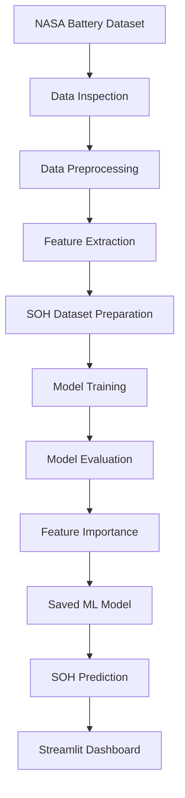

# ⚡ VOLTEX – EV Battery Health Monitoring & Predictive Analytics

<p align="center">
  <strong>Machine Learning-Based State of Health (SOH) Prediction for Electric Vehicle Batteries</strong>
</p>

<p align="center">
  
  
  
  
  
</p>

---

## 📌 Overview

**VOLTEX** is a machine learning-based EV battery health monitoring and predictive analytics project designed to estimate the State of Health (SOH) of lithium-ion batteries using battery discharge characteristics.

The system analyzes battery performance data, extracts meaningful features, trains supervised machine learning models, and evaluates their ability to predict battery health.

The project also includes a Streamlit-based dashboard for exploring battery health information and model outputs.

## 🎯 Project Objectives

- Estimate battery State of Health (SOH).
- Analyze battery capacity degradation over charge-discharge cycles.
- Extract meaningful electrical and thermal features.
- Train and compare supervised machine learning models.
- Evaluate model generalization using Leave-One-Battery-Out Cross-Validation.
- Visualize battery health trends and model performance.

## 🧠 Machine Learning Approach

The project follows a structured supervised learning pipeline:

1. Data inspection and preprocessing.
2. Feature extraction from battery discharge measurements.
3. SOH dataset preparation.
4. Model training and comparison.
5. Model evaluation using cross-validation.
6. Feature importance analysis.
7. Model saving and prediction testing.

### Models Evaluated

| Model | MAE | RMSE | R² |
|---|---:|---:|---:|
| Extra Trees | **2.6213** | 3.8481 | 0.8759 |
| Ridge Regression | 3.2859 | **3.8362** | **0.8766** |
| Random Forest | 3.4927 | 4.7298 | 0.8125 |

*Evaluation results are from Leave-One-Battery-Out Cross-Validation.*

**Model selection:** Extra Trees achieved the lowest MAE, while Ridge Regression achieved slightly lower RMSE and slightly higher R². Therefore, model selection depends on the evaluation metric rather than assuming one model is best in every respect.

## 📊 Key Results

- Dataset contains 636 observations across four NASA battery cells.
- Battery health is estimated using discharge capacity relative to the first recorded discharge capacity of each battery.
- Extra Trees achieved an MAE of approximately 2.62 SOH percentage points under Leave-One-Battery-Out Cross-Validation.
- Feature importance analysis helps identify influential battery characteristics.
- Battery-wise validation is used to assess generalization to an unseen battery.

## 🔋 State of Health (SOH)

SOH is calculated using:

\[
SOH(\%) = \frac{\text{Current Discharge Capacity}}{\text{Initial Recorded Discharge Capacity}} \times 100
\]

The initial recorded discharge capacity is used as the reference for each battery.

## 🗂️ Project Structure

```text
VOLTEX/
│
├── app.py
├── inspect_nasa_alt.py
├── check_suspicious_readings.py
│
├── data/
│   └── processed/
│       ├── battery_features.csv
│       └── soh_model_dataset.csv
│
├── model/
│   ├── soh_extra_trees.pkl
│   └── soh_features.pkl
│
├── notebooks/
│   ├── 11_prepare_soh_dataset.py
│   ├── 12_train_soh_model.py
│   ├── 13_evaluate_soh_model.py
│   ├── 14_feature_importance.py
│   ├── 17_save_soh_model.py
│   └── 18_test_soh_prediction.py
│
├── reports/
├── result/
├── src/
│
├── .gitignore
└── README.md
```

## 🔄 Project Workflow



## 🛠️ Technologies Used

| Technology | Purpose |
|---|---|
| Python | Programming language |
| Pandas | Data manipulation |
| NumPy | Numerical computations |
| Scikit-learn | Machine learning |
| SciPy | Scientific data processing |
| Plotly | Interactive visualizations |
| Streamlit | Interactive dashboard |
| Matplotlib | Data visualization |

## 🚀 Installation & Execution

### 1. Clone the Repository

```bash
git clone https://github.com/Riniverma/VOLTEX-EV-Battery-Health-Prediction.git
```

### 2. Navigate to the Project

```bash
cd VOLTEX-EV-Battery-Health-Prediction
```

### 3. Install Dependencies

```bash
pip install streamlit pandas numpy scikit-learn scipy plotly matplotlib
```

### 4. Run the Dashboard

```bash
streamlit run app.py
```

The dashboard will open in your browser.

## 📁 Dataset Information

This project uses battery data from NASA's Prognostics Center of Excellence (PCoE).

The processed SOH dataset is included in this repository.

Large raw datasets are excluded to keep the repository lightweight. Users should obtain the original datasets from NASA's official data repository before reproducing the complete preprocessing workflow.

## ⚠️ Limitations & Future Scope

- The current implementation focuses on SOH prediction.
- Remaining Useful Life (RUL) prediction is not yet implemented as a validated model.
- The available NASA PCoE dataset contains only four battery cells for the current SOH experiments.
- Performance on unseen batteries and different operating conditions requires further validation.
- Future work can include more battery datasets, improved generalization, RUL modelling, and real-time battery monitoring.

## 🔮 Future Enhancements

- Develop a validated Remaining Useful Life prediction model.
- Integrate additional battery datasets.
- Improve model generalization across battery types.
- Add real-time battery monitoring capabilities.
- Explore advanced ensemble and deep learning approaches.

## 👩‍💻 Author

**Rini Verma**

GitHub: [@Riniverma](https://github.com/Riniverma)

## 📄 License

This project is intended for educational and research purposes.

---

<p align="center">
  <strong>VOLTEX – Intelligent Insights for EV Battery Health</strong>
</p>
